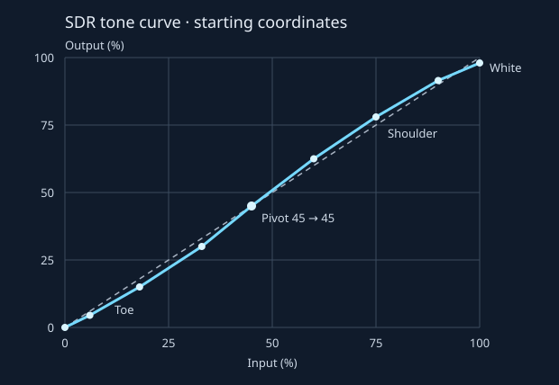

# Ryo参考：Press Machineのカーブ設定リファレンス

[「Hello FX5 Setup.」0:50–1:05](https://youtu.be/LacjCmbb3X0?t=50) の街角を起点にした設定案。**明暗カーブは「黒点を固定し、すぐ上の段差を残す。中間調で少し傾きを増やし、白は上端に向けてなだらかにする」。青灰の影・クリーム色の日向は別の色操作。** Press Machineの `Luma Curve TEST` は、この明暗カーブを描く欄ではなく、`Luma Split` が輝度ごとにどの程度・どちらの色方向に働くかを設定する欄です。

## 1. 明暗カーブ：Resolveで描く

次の座標は**Rec.709 / Gamma 2.4 のSDR表示用信号を前提にした、無彩色ランプ上の目安**。横軸＝入力、縦軸＝出力。名目ブラックを0%、名目ホワイトを100%とした概念座標で、IREや10-bitコード値を入力する欄、DIの値、EV、Resolveのスライダー値ではありません。Resolveのグラフ位置に概略で置き、最終的な出力を波形で確認します。動画から逆算した点でも、Resolve実機で検証済みのプリセットでもありません。

| 入力 % | 出力 % | 役割 |
| ---: | ---: | --- |
| 0 | 0 | **黒点**。左下を固定。黒を沈めたいからと右へ寄せ、暗部をまとめて黒にしない。 |
| 6 | 4.5 | **トーの低い側**。少し沈めるが、黒点からの傾きを残す。 |
| 18 | 15 | **トーの上**。路面と青灰の壁を、黒い入口と分ける位置。 |
| 33 | 30 | **下側ミッド**。ピボットを固定したまま、下側の傾きを作る。 |
| 45 | 45 | **ミッドのピボット**。明暗カーブ上の固定点。Pressの `Luma Pivot EV` とは無関係。 |
| 60 | 62.5 | **上側ミッド**。ピボットの前後で傾きを緩やかに増やす。 |
| 75 | 78 | **ショルダーの入口**。明部は持ち上げすぎず、傾きを落とし始める。 |
| 90 | 91.5 | **ショルダーの後半**。日向や白い面の中に明るさの差を残す。 |
| 100 | 98 | **白端のロールオフ**。白が強すぎる場合の開始値。白を定位置に残したい素材では、この点だけでなく直前の形も調整し、後半が急に立たないかランプで確認。クリップ済みの白は戻らない。 |

1. **既にRec.709/Gamma 2.4に整った信号**なら、その後ろに専用ノードを足します。DWG/Intermediateなどから作業する場合にこの数値を試すなら、隔離した非管理DaVinci YRGBで `素材を正規化 → 露出/WB → Press（DWG/Intermediateなら入出力Same） → 明示的なSDR出力変換 → 表示域のCustom Curves` とします。Pressの `Input Primaries` / `Input Transfer` は実際のノード入力に一致させます。既存のRCMワークフローでは、通常のColorノードにこれらの表示域座標をそのまま移植したり、追加CSTで二重出力変換したりしないでください。RCMの作業域で調整するなら、**形と波形の狙い**だけ参照し、点はその信号域で置き直します。
2. **Color → Curves → Custom Curves**。まず `Gang Custom Curves` を外して **Y（Luma）** を選択。初期状態から黒端・白端と中間点を置き、`Input` 側ヒストグラム、出力の波形、無彩色ランプで確認します。図の線分は点の並びを示すだけで、実スプラインの補間ではありません。トーやショルダーに平坦部・反転・急な曲がりが出たら、点を減らすか `Editable Splines` の接線を緩めます。ミッドは45の点を保ち、33と60の点で傾きを調整する方が、全体のコントラストを重ねるより分離しやすいです。Yだけでも見かけの彩度は変わり得ます。RGBまで連動した場合との違いをパレードやベクトルスコープで確認します。
3. **白端を下げることと、白に向けて圧縮することは別**。まず75・90・100のつながりで肩を作ります。明部の階調を残すために `High Clip` を下げるのは逆効果です。別案として、まだ階調のある信号にだけ、カーブとの二重圧縮を避けて `Soft Clip > High Soft` を少し足し、増減を比較します。`High Soft` はハード上限を下げるつまみではありません。

**ショット別にどこを触るか：**

- **0:52–0:56.5、青灰の壁と街角：** 入口を黒に近く保ちつつ、壁・路面の差が詰まるなら、まず `6→4.5` を `6→5.5`、`18→15` を `18→16.5` に近づける。`0→0` はそのまま。明るい外壁の色はカーブの白端で作らない。
- **0:59.5–1:04、ビル街：** 暗部の面積が大きいので、最初はトーを弱めるかバイパス。後半に大きな明部がないことを欠陥とみなさず、75〜100を使わせるために白を無理に持ち上げない。
- **0:50付近の顔／0:57–0:59の空：** 顔はトーで帽子・髭の段差を潰さない。空はトーと寒暖Splitをいったん切り、白雲と空の差に合わせる。1本を全カットに適用しない。

Resolveの操作名・軸の向きは、同梱リファレンスマニュアルの **Color / Chapter 134 “Curves”**（pp.3193–3197、Soft Clipはpp.3198–3201）に照合。上の座標やスプライン挙動は今回のResolve実測ではありません。

## 2. Press Machineのカーブ：寒暖だけを合わせる

[公開v2.2.1](https://github.com/46slv/press-machine/releases/tag/ofx/v2.2.1)（ビルド元 `9e235de0a3f2fb1f87e4122ad8f354e7c6f598f4`、内部ID `com.46slv.PressMachine.v3.curve.dev`／OFX 3.1）と[初期29操作子のv3 Curve Dev](PressMachine-Luma-Curve-Prototype.md)の記録は別。いずれの `Luma Pivot EV`／`Luma Width` もHueの応答用で、黒点、トー、明暗のミッド傾き、ショルダー、白の輝度を置く操作子ではありません。手元で旧バンドル名に `V3CurveDev` と出ても、バイナリの版を同一視しません。

| 実際の操作子 | 効く部分 | 出発点（実写用の確定値ではない） |
| --- | --- | --- |
| `Luma Split`（−300〜+300、既定0）／`Hue Angle`（0〜360、既定0） | 寒暖の向きと量。`Hue Bias=0` かつ `Luma Split>0` ではPivotより上がAngle側、下が反対側。負のSplitで逆転。 | `Hue Strength=0`、`Hue Bias=0`、Angle `55`。Splitは `0` → `+10`を試し、向き比較にCPUで実測した `+20` / `−20`。AngleはHSVの角度ではない。 |
| `Luma Pivot EV`（−6〜+6、既定0） | 参照リニアXYZ Yの反転位置。`Hue Bias=0` では `Y=0.18×2^EV`。黒点や露出のピボットではない。 | `0.00`。青がミッドに広がり過ぎれば `−0.50`（境目のYは約.127）。青の帯を上へ広げたい場合だけ `+0.50`（約.255）。 |
| `Luma Width`（0.25〜4、既定1） | 輝度に対する**色寄せ**の傾き。大きいほどピボット周辺の反応が緩い。対称系なので影と明部の傾きを個別には作れない。 | `1.00`。中間調の色変化が強ければ `1.40` と比較。Splitが0ならPivot/Widthは画に効かない。 |
| `Shadow Desat Threshold` / `Shadow Desat Knee` | 色付きの黒を無彩色寄りにする。明暗のトーではない。処理後 `DI(Y)` 座標で、最暗部の色だけを調整。 | まずThreshold `0`（OFF）。青灰の壁まで抜けない場合に限り、CPU診断値 `.16` / `.09` を弱い側から試す。`Highlight Desat Threshold=1`（OFF）でクリームを残す。 |

RGBパレードで無彩色の黒が青くなり過ぎていないか確認。**影を青にしても日向を独立にクリームにできない**ときは、Splitを弱め、別ノードで `Gang Custom Curves` を外して必要なR/G/Bチャンネルだけ調整するか、`Hue vs Hue` / `Hue vs Sat`、HSL Qualifierや柔らかいPower Windowで壁・日向・肌を分けます。無彩色の黒と白はチャンネル曲線の端を揃え、肌や赤い小物を無差別に染めないこと。`Density` は彩度に応じて色付きの領域を暗く／明るくする処理で、黒点や白いショルダーの代用にはしません。

固定ソースCPUの `pm_vnext_curve` 比較では、Pivot `0`、入力Y `.045/.18/.72` でWidth `1.00` の応答 `q` は `−.33333/0/+.33333`、Width `1.40` では `−.26316/0/+.26316`。`q` はSplitの色変化への中間値で、画素Yの出力ではありません。[先行CPU試験](PressMachine-2.2.1-Ryo-Look-CPU.json)で、設定例のSplit単独は試験パッチのYを最大絶対差 `8.69e−8` の範囲で保持。`Shadow Desat .16/.09` は `.003` の着色グレーを無彩色に戻し、`.04` ではSplitによる色を保ちました。これは**合成入力のソースCPU比較**で、実写・今回のResolveレンダーや公開`.ofx`の実行結果ではありません。[応答の実装](https://github.com/46slv/press-machine/blob/9e235de0a3f2fb1f87e4122ad8f354e7c6f598f4/core/press_machine/HueLumaCurve.dctlh#L5-L28) · [HueとYの処理](https://github.com/46slv/press-machine/blob/9e235de0a3f2fb1f87e4122ad8f354e7c6f598f4/core/press_machine/VNextHue.dctlh#L76-L100)

## 3. 参照から言えること／言えないこと

全画面の目安として、配信抜粋をデコードした代表コマの8-bit BT.709 TVレンジY′を比較しました。下表は面積ベースの分位点（範囲外値も含めて集計、16→0%、235→100%と正規化）。画面のどこがその値か、肌・壁・白雲ごとの値を示すものではありません。

| 代表位置（概算） | 画 | P5 % | P50 % | P95 % | P99 % |
| --- | --- | ---: | ---: | ---: | ---: | ---: |
| 0:50.5 | 顔 | 0.0 | 40.2 | 79.0 | 86.3 |
| 0:53.0 | 青灰の壁 | 0.0 | 26.9 | 64.8 | 84.5 |
| 0:55.5 | 標識のある街角 | 0.0 | 6.8 | 59.8 | 68.0 |
| 0:58.0 | 空・電線 | 0.0 | 26.5 | 41.6 | 53.9 |
| 1:00.5 | ビル街・明るい外壁 | 0.0 | 5.0 | 42.9 | 72.1 |
| 1:03.0 | ビル街の暗い画 | 0.0 | 4.6 | 28.3 | 45.2 |

暗い端はどのコマにもありますが、中間調と明部の面積はショットで違います。この差を消すような同一S字はかけません。**Y′分位点は配信の出力側の観測で、カーブへの入力点でも、「このカーブで再現できた」という証拠でもありません。** 公開動画と[先行の静止画メモ](https://github.com/46slv/press-machine/blob/8afc47b6bf2a76e30fdb09a8acbc24f6d008297e/tests/satcomp-gamut-edge/look-reference-ryo-ichikawa.md)だけから、編集前の元カーブ・撮影条件・LUTは特定できません。

**比較の順：** 同じ入力を、①バイパス、②明暗カーブのみ、③明暗カーブ＋PressのHue応答（実際のノード順は上記の色管理に従う）で比較します。ランプで黒の直上と白の直下に段差が残るか、実写で暗い入口と壁、クリームと白雲、肌や赤の区別が残るかを見る。今回のカーブ案はResolve実機で作成・保存・レンダーしていません。次に実機で詰めるときは、同IDのOFXが競合しない環境で、合成ランプと権利を確認した未グレード実写を使います。機能全般・配信コマの観察・ホスト差は[先行分析](PressMachine-2.2.1-Ryo-Look-JA.md)を参照。
